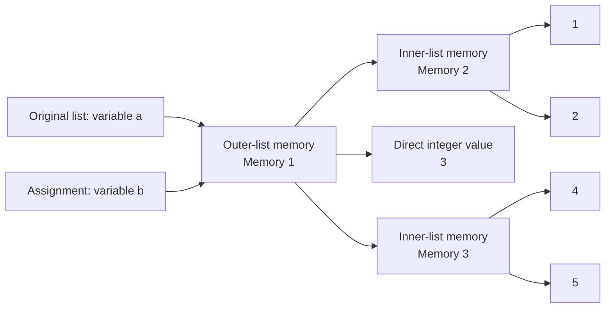
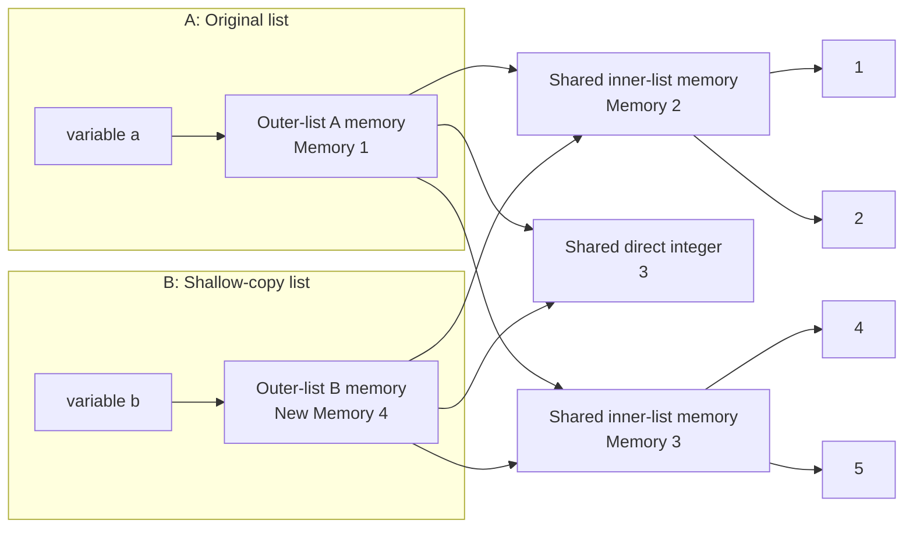
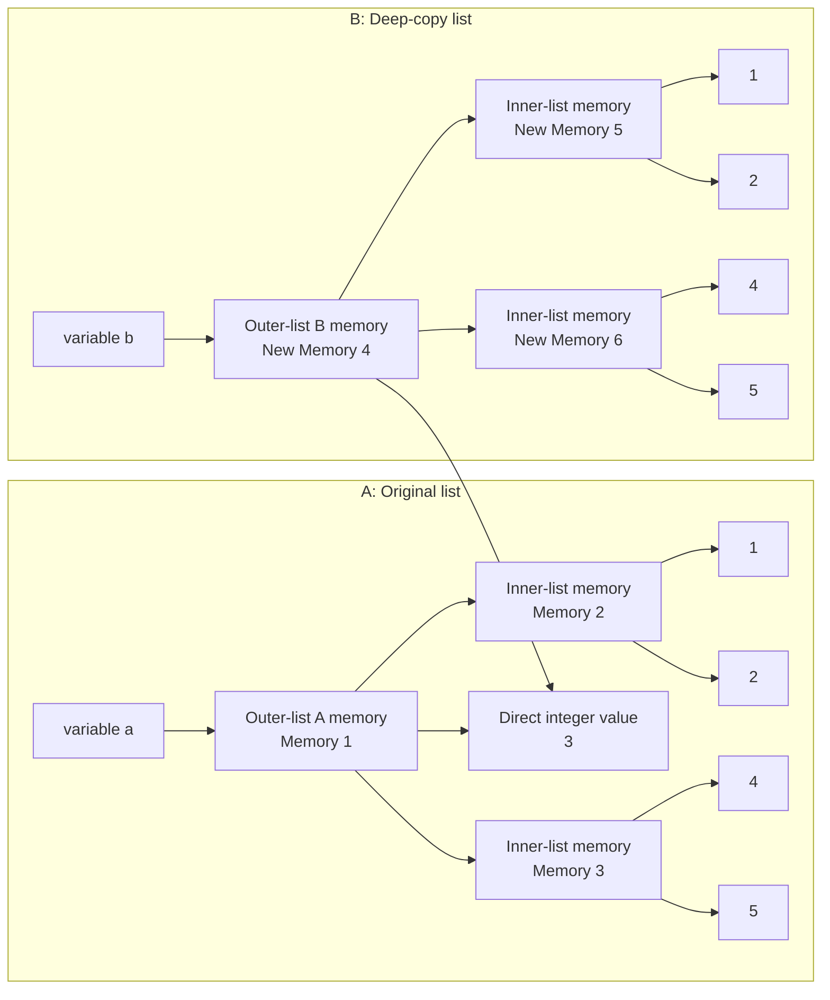

# Python Interview Workshop Cheat Sheet

Use this as the quick-reference handout for a lab-first Python workshop.

## Workshop Flow

1. **Core collections:** Lists, tuples, and dictionaries  
2. **Strings:** Methods, indexing, and slicing  
3. **Comprehensions:** Filtering, transforming, and nested loops  
4. **Sets:** Unique values and set operations  
5. **Object references:** Assignment, shallow copy, deep copy, and memory  
6. **Reliability:** Built-in and custom exception handling  
7. **Code organization:** Creating and importing custom modules  
8. **Interview revision:** Short, common Python patterns  

## 1. Collections

### List vs Tuple

| Feature | List | Tuple |
|---|---|---|
| Syntax | `[]` | `()` |
| Mutable | Yes | No |
| Typical use | Data that changes | Fixed data |
| Methods | Many | `count()`, `index()` |

> **Tuple note:** An empty tuple is valid: `empty_tuple = ()`. For a one-item tuple, the comma creates the tuple: `single_value = (10,)`. Without the comma, `(10)` is simply the integer `10`.
>
> **Interview note:** Lists are mutable; tuples are immutable. A tuple can be a dictionary key only when every item inside it is hashable.

### List Methods

```python
nums = [3, 1, 2]
```

| Method | One-line explanation |
|---|---|
| `name_list.append(x)` | Adds `x` to the end of the list. |
| `name_list.extend(items)` | Adds every item from another iterable to the end. |
| `name_list.insert(i, x)` | Inserts `x` before index `i`. |
| `name_list.remove(x)` | Removes the first matching value; raises an error if absent. |
| `name_list.pop()` | Removes and returns the last item. |
| `name_list.pop(i)` | Removes and returns the item at index `i`. |
| `name_list.sort()` | Sorts the original list in place. |
| `name_list.reverse()` | Reverses the original list in place. |
| `name_list.index(x)` | Returns the first index containing `x`. |
| `name_list.count(x)` | Returns how many times `x` occurs. |
| `name_list.copy()` | Makes a shallow copy of the list. |
| `name_list.clear()` | Removes every item from the list. |

### `sort()` vs `sorted()`

| Feature | `name_list.sort()` | `sorted(iterable)` |
|---|---|---|
| Works on | Lists only | Any iterable, such as a list, tuple, string, or dictionary |
| Original object | Changes the original list | Leaves the original object unchanged |
| Return value | Returns `None` | Returns a new sorted list |

```python
numbers = [3, 1, 2]

# sort(): changes the same list
numbers.sort()
print(numbers)  # [1, 2, 3]

# sorted(): creates a new list
numbers = [3, 1, 2]
new_numbers = sorted(numbers)
print(numbers)      # [3, 1, 2]
print(new_numbers)  # [1, 2, 3]
```

```python
# Common syntax for both
name_list.sort(reverse=True)
new_list = sorted(iterable, reverse=True)
new_list = sorted(iterable, key=len)
```

> **Interview note:** Use `sort()` when you deliberately want to change a list. Use `sorted()` when you need a new sorted list or the source is not a list.

### Tuple Methods

| Method | One-line explanation |
|---|---|
| `data_tuple.count(x)` | Returns how many times `x` occurs in the tuple. |
| `data_tuple.index(x)` | Returns the first index containing `x`. |

### Dictionary Methods

```python
user = {"name": "Asha", "age": 25}
```

> **Interview note:** Dictionary keys must be unique and hashable. Assigning the same key again replaces its earlier value; values can repeat.

| Method | One-line explanation |
|---|---|
| `user_dict.get(key, default)` | Returns a value safely, or `default` when the key is missing. |
| `user_dict.keys()` | Returns a view of all dictionary keys. |
| `user_dict.values()` | Returns a view of all dictionary values. |
| `user_dict.items()` | Returns key-value pairs for iteration. |
| `user_dict.update(data)` | Adds or replaces several key-value pairs. |
| `user_dict.pop(key)` | Removes a key and returns its value. |
| `user_dict.popitem()` | Removes and returns the last inserted key-value pair. |
| `user_dict.setdefault(key, default)` | Returns a key’s value and creates it with `default` if missing. |
| `user_dict.copy()` | Makes a shallow copy of the dictionary. |
| `user_dict.clear()` | Removes every key-value pair. |

## 2. Strings, Indexing, and Slicing

### String Methods

```python
text = "  Python Interview  "
```

> **Interview note:** A string does not need unique characters. Strings are immutable, so methods such as `replace()` and `strip()` return a new string instead of changing the original one.

| Method / operator | One-line explanation |
|---|---|
| `text.lower()` | Converts every letter to lowercase. |
| `text.upper()` | Converts every letter to uppercase. |
| `text.title()` | Capitalizes the first letter of each word. |
| `text.strip()` | Removes whitespace from both ends. |
| `text.lstrip()` | Removes whitespace from the left end. |
| `text.rstrip()` | Removes whitespace from the right end. |
| `text.replace(old, new)` | Replaces every occurrence of `old` with `new`. |
| `text.split(separator)` | Splits a string into a list. |
| `separator.join(items)` | Combines strings from an iterable using a separator. |
| `text.startswith(prefix)` | Checks whether the string begins with `prefix`. |
| `text.endswith(suffix)` | Checks whether the string ends with `suffix`. |
| `text.find(value)` | Returns the first index of a value, or `-1` when absent. |
| `text.index(value)` | Returns the first index of a value, or raises an error when absent. |
| `text.count(value)` | Counts occurrences of a value. |
| `text.isalpha()` | Checks whether all characters are letters. |
| `text.isdigit()` | Checks whether all characters are digits. |
| `text.isalnum()` | Checks whether all characters are letters or digits. |
| `+` | Concatenates strings: `"Py" + "thon"`. |
| `*` | Repeats a string: `"ha" * 3`. |

### Indexing

```python
name = "Python"
nums = [10, 20, 30, 40, 50]
```

Indexing accesses one item by its position.

| Syntax | One-line explanation |
|---|---|
| `name[0]` | Gets the first item. |
| `name[-1]` | Gets the last item. |

### Slicing

Slicing accesses a range of items using `sequence[start:end:step]`.

> **Interview note:** Slicing returns a new sequence. The end index is excluded, and negative indexes count from the right.

| Syntax | One-line explanation |
|---|---|
| `name[start:end]` | Gets items from `start` up to, excluding, `end`. |
| `name[::2]` | Gets every second item from left to right. |
| `name[::-1]` | Reverses a string, list, or tuple in one line. |
| `name[5:1:-1]` | Moves right to left using a negative step. |

## 3. List Comprehension

> **Interview note:** A list comprehension creates a list in one line. It is best for a simple expression, loop, and optional condition; use normal loops when the body needs several statements.

### 3.1 Basic Pattern

```python
# Syntax: output expression comes first; for clause comes last.
[expression for item in iterable]

squares = [n * n for n in range(1, 6)]
# [1, 4, 9, 16, 25]
```

### 3.2 Filter Pattern — `if` After `for`

```python
# Syntax: the condition after for decides which items remain.
[expression for item in iterable if condition]

even_squares = [n * n for n in range(1, 11) if n % 2 == 0]
# [4, 16, 36, 64, 100]
```

Use this pattern when you want to **skip** items that do not match the condition.

### 3.3 Conditional Pattern — `if/else` Before `for`

```python
# Syntax: every item remains; the output changes by condition.
[value_if_true if condition else value_if_false for item in iterable]

labels = ["even" if n % 2 == 0 else "odd" for n in range(5)]
# ["even", "odd", "even", "odd", "even"]
```

Use this pattern when you want to **keep every item** but return different output values.

### 3.4 Nested Pattern — Outer and Inner Loops

```python
# Syntax: outer for comes first, followed by each inner for.
[expression for outer_item in outer_iterable for inner_item in inner_iterable]

# The beginning expression can use both variables.
[f"{team}: {member}" for team in teams for member in members]

matrix = [[1, 2], [3, 4]]
flat = [number for row in matrix for number in row]
# [1, 2, 3, 4]

teams = ["Red", "Blue"]
members = ["Asha", "Ravi"]
pairings = [f"{team}: {member}" for team in teams for member in members]
# ["Red: Asha", "Red: Ravi", "Blue: Asha", "Blue: Ravi"]
```

```python
# Equivalent normal nested loops
result = []
for outer_item in outer_iterable:
    for inner_item in inner_iterable:
        result.append(output_expression)
```

Use normal nested loops when the inner block needs multiple statements, such as creating a variable, printing a value, and appending a result.

## 4. Set Methods

> **Interview note:** A set stores unique, unordered, hashable items. It automatically removes duplicates, and it cannot contain a list or dictionary.

| Method | One-line explanation |
|---|---|
| `skill_set.add(x)` | Adds one item to the set. |
| `skill_set.update(items)` | Adds every item from another iterable. |
| `skill_set.remove(x)` | Removes `x`; raises an error if it is missing. |
| `skill_set.discard(x)` | Removes `x` without raising an error if it is missing. |
| `skill_set.pop()` | Removes and returns an arbitrary item. |
| `skill_set.union(other)` | Returns all unique items from both sets. |
| `skill_set.intersection(other)` | Returns items common to both sets. |
| `skill_set.difference(other)` | Returns items present only in the first set. |
| `skill_set.symmetric_difference(other)` | Returns items found in exactly one of the sets. |

## 5. Assignment, References, and Copies

```python
a = [1, 2, 3]
b = a                 # b points to the same list
c = a.copy()          # c is a new outer list
```

`a = b` copies a reference, so changing a mutable object through either name changes the same object.

> **Interview note:** Use `is` to compare object identity and `==` to compare values.

```python
import copy

original = [[1, 2], 3, [4, 5]]
assignment = original
shallow_copy = copy.copy(original)
deep_copy = copy.deepcopy(original)
```

| Type | One-line explanation |
|---|---|
| Assignment: `b = a` | No new list memory is created; both names point to the same outer and inner objects. |
| Shallow copy | Creates memory for a new outer list, but its nested lists still point to the original inner-list memory. |
| Deep copy | Creates memory for a new outer list and new memory for every nested inner list. |

### Assignment: Original List First, Then `b = a`



Both names point to the same outer list and the same inner lists.

### Shallow Copy: Original List First, Then `b = a.copy()`



The outer list is new, but both outer lists share the same inner lists.

### Deep Copy: Original List First, Then `b = copy.deepcopy(a)`



The outer list and every inner list are new and independent.

> **Interview note:** The direct value `3` is an immutable integer. Even `copy.deepcopy()` normally reuses immutable values; it creates new objects for the mutable nested lists.

### Effect of Changing an Inner List

```python
original = [[1, 2], 3, [4, 5]]
shallow_copy = copy.copy(original)
deep_copy = copy.deepcopy(original)

original[0].append(99)

print(shallow_copy)  # [[1, 2, 99], 3, [4, 5]]
print(deep_copy)     # [[1, 2], 3, [4, 5]]
```

| Copy type | When an inner list in `original` changes |
|---|---|
| Assignment | The change appears because both names use the same outer list. |
| Shallow copy | The change appears because both outer lists share the same inner lists. |
| Deep co | The change does not appear because it has separate inner lists. |

## 6. Memory Management

- Variables store references to objects, not the objects themselves.
- Mutable objects include lists, dictionaries, and sets; they can change in place.
- Immutable objects include integers, strings, and tuples; a “change” creates a new object.
- Python primarily reclaims memory through reference counting.
- Its garbage collector handles unreachable circular references.
- `id(value)` returns an object’s identity for reference comparisons.

```python
a = [1, 2]
b = a
print(id(a) == id(b))  # True
```

### Reference Counting Example

```python
data = [10, 20]
first_alias = data
second_alias = data

# The same list object is referenced by: data, first_alias, and second_alias.
print(data is first_alias is second_alias)  # True
```

In CPython, every reference increases an object’s reference count. When the count reaches zero, Python can reclaim that object’s memory.

```python
import sys

data = [10, 20]
alias = data
print(sys.getrefcount(data))  # Usually 3: data, alias, and this function call
```

### Ordered, Mutable, and Immutable Types

| Type | Ordered? | Mutable? | Memory behavior |
|---|---|---|---|
| List | Yes | Yes | Changes such as `append()` modify the same list object. |
| Tuple | Yes | No | A change creates a new tuple object. |
| String | Yes | No | A change such as concatenation creates a new string object. |
| Dictionary | Yes, insertion order from Python 3.7+ | Yes | Adding or changing a key modifies the same dictionary object. |
| Set | No | Yes | Items have no fixed position; adding or removing modifies the same set object. |

> **Interview note:** “Ordered” means elements retain a predictable position for indexing or iteration. Dictionaries preserve insertion order, but they are accessed by keys rather than numeric indexes. Sets are unordered and cannot be indexed.

## 7. Custom Exception Handling

`except Exception:` is too broad for normal application code; catch the specific exception you expect whenever possible.

```python
class InvalidAgeError(Exception):
    """Raised when an applicant is younger than the minimum age."""

    def __init__(self, age, minimum_age=18):
        self.age = age                  # custom data on the exception object
        self.minimum_age = minimum_age
        message = f"Age must be at least {minimum_age}; received {age}."
        super().__init__(message)       # stores the message in the base Exception


def register(age):
    if age < 18:
        raise InvalidAgeError(age)      # creates and raises an exception object
    return "Registration successful"


try:
    print(register(16))
except InvalidAgeError as error:
    print(str(error))           # Age must be at least 18; received 16.
    print(error.age)            # 16
    print(error.minimum_age)    # 18
else:
    print("Registration completed without an error.")
finally:
    print("Validation completed.")
```

### Custom Exception Class and Constructor

| Syntax | One-line explanation |
|---|---|
| `class InvalidAgeError(Exception):` | Creates a custom exception that inherits normal exception behavior. |
| `def __init__(self, age, minimum_age):` | Defines the constructor and receives data when the exception object is created. |
| `self.age = age` | Stores custom data on the exception object. |
| `super().__init__(message)` | Passes the readable error message to the parent `Exception` class. |
| `raise InvalidAgeError(age)` | Creates an exception object and stops normal execution. |
| `except InvalidAgeError as error:` | Stores the raised exception object in `error`. |
| `str(error)` | Reads the error message supplied to `super().__init__()`. |
| `error.age` | Reads a custom attribute stored on the exception object. |

| Keyword | One-line explanation |
|---|---|
| `try` | Contains code that may raise an exception. |
| `except` | Handles a matching exception. |
| `else` | Runs only when the `try` block succeeds. |
| `finally` | Runs whether an error occurs or not. |
| `raise` | Explicitly creates an exception. |
| `class MyError(Exception)` | Defines a custom exception type. |

### Important Exception Notes

- Catch specific exceptions before broad ones: write `except ValueError:` before `except Exception:`.
- Avoid a bare `except:` because it hides unexpected problems.
- Use `else` for code that should run only when the `try` block succeeds.
- Use `finally` for cleanup, such as closing a file or database connection.
- Use `raise` again inside an `except` block to re-raise the current error.
- Use `raise NewError("message") from error` to preserve the original error as the cause.
- Built-in exceptions include `ValueError`, `TypeError`, `KeyError`, `IndexError`, `FileNotFoundError`, and `ZeroDivisionError`.

## 8. Creating a Custom Module

> **Interview note:** Python runs code at the top level of an imported module. Protect executable test code with `if __name__ == "__main__":`.

### `calculator.py`

```python
def add(a, b):
    return a + b


def subtract(a, b):
    return a - b
```

### `main.py`

```python
import calculator

print(calculator.add(10, 5))
```

| Term | One-line explanation |
|---|---|
| Module | A single `.py` file containing reusable Python code. |
| Package | A folder that groups related Python modules. |
| `import calculator` | Imports the whole module. |
| `from calculator import add` | Imports only the named item. |

## 9. Rapid Interview Snippets

```python
# Reverse a string or list
value[::-1]

# Swap two variables
a, b = b, a

# Palindrome test
text == text[::-1]

# Frequency counter
frequency = {}
for char in text:
    frequency[char] = frequency.get(char, 0) + 1
```

